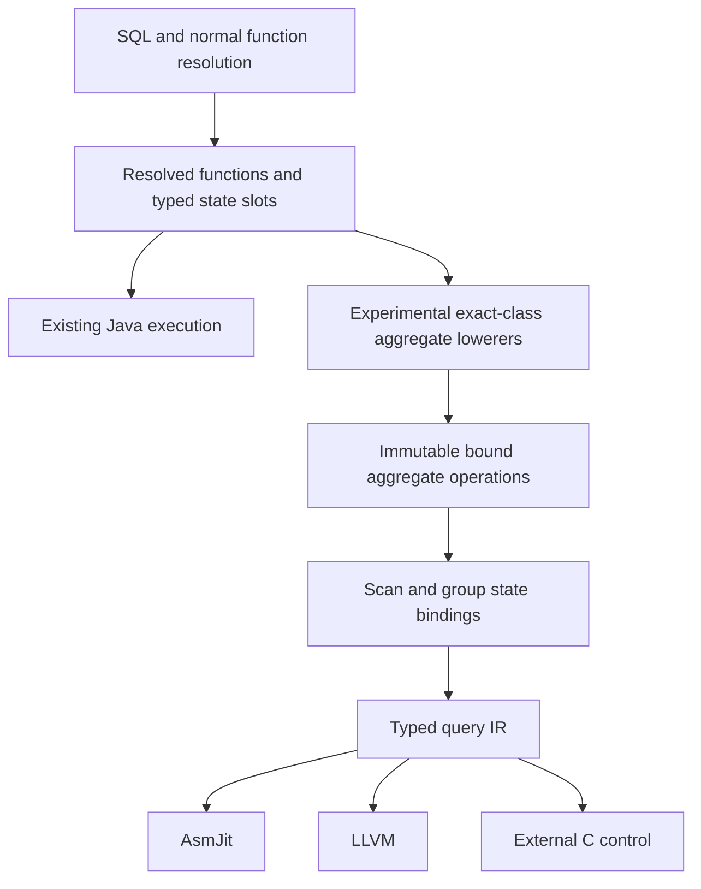

# Integrating compiled aggregates with QuestDB

Status: proposed design, grounded in the checkout at `8da4e347f96563dc4e9d13916e00177e2af708f9`
and the uncommitted `experimental/query-compiler` prototype. Source inspection and
the small executable contract checks below were performed on 2026-10-25. Proposed
interfaces and behavior are explicitly identified; they are not implemented yet.

The [foundation integration plan](FOUNDATIONS_PLAN.md) now governs implementation
order and the final runtime shape. It retains this document's resolution and
ownership contracts, but evaluates existing map/batch interoperation before a
separate native table/factory and does not stop at serial execution.

## Decision

**Execution priority, updated 2026-10-25:** establish parallel execution of existing
operators before extending coverage. `ParallelGroupBy` now lowers the Java
sharding and aggregate-merge algorithms over the existing prototype table ABI.
It reuses the core allocator factory and slot locks. Its executor/frame barrier,
outer table and lack of map pre-sizing remain explicit integration differences;
it is not yet the production asynchronous runtime. See the [parallel prototype
contract](README.md#working-with-it) and the progress log. Future changes must
start from the Java algorithms and an executable Java oracle, not invent a second
merge/allocation strategy.

Connect native compilation to the aggregate functions selected by normal QuestDB
resolution. Initially use explicit lowerers for concrete resolved implementations.
Preserve the regular Java implementations and existing planner specializations.
Evaluate generating Java and native IR from a shared aggregate definition as a
separate, bounded experiment after the integration works.

This deliberately separates two deliverables:

1. **Integration:** one SQL resolution path, authoritative types, explicit lifecycle
   and ownership, and a compiled implementation selected for supported operations.
2. **Implementation sharing:** one definition of an aggregate's operations that can
   generate both ordinary Java and native query code.

The first deliverable still duplicates update logic. Connecting a lowerer to a
resolved function makes that duplication visible and testable; it does not remove
it. The second deliverable is conditional on correctness, maintainability and
regular-path performance checks.

## Scope and completion criteria

The first integrated slice supports the resolved implementations of `COUNT(*)`,
`COUNT(LONG)` and `SUM(LONG)`, grouped or global, with multiple fixed-width keys and
multiple aggregates. It is serial and explicitly enabled. Direct column arguments
are sufficient for this slice. Constants and casts require their own resolution
tests before admission; matching a function name or SQL spelling is insufficient.

Start with unfiltered native table scans. Add filters only when the compiler can
prove that the input row selection is preserved. Existing DSL fixtures may continue
to exercise broader expressions, joins and DISTINCT while the integrated path is
being developed. A rejected integrated query must not silently return to the old
name-based experimental SQL lowering.

Completion means that ordinary SQL resolution supplies the concrete functions,
the same compiled aggregate components serve the integrated path and DSL tests,
and every accepted query has validated input, state, output and ownership contracts.
It does not mean that the prototype's outer hash table has become QuestDB's map,
that arbitrary Java functions can be compiled, or that native compilation is
automatically preferable to the existing plan.

Subsequent slices add finalization and floating-point support for AVG, then owned
state for DISTINCT. Parallel execution, SAMPLE BY/fill, windows, shared cursors,
automatic tier switching and general SQL join lowering remain separate work.

## Assumptions checked in code

| Assumption | Current code and consequence |
| --- | --- |
| SQL already resolves overloads and result types. | `assembleGroupByFunctions` calls `FunctionParser.parseFunction`, uses `func.getType()`, and initializes aggregate value types. Consume those results instead of reinterpreting names. [Resolution][resolution] [State assignment][state-assignment] |
| All aggregation passes through that assembly point. | False. Fused join/group, SAMPLE BY, global COUNT, posting-index DISTINCT and vector aggregation have earlier branches. Put an optional hook on the ordinary resolved branch and preserve the earlier decisions. [Planner][planner] [Vector branch][vector-branch] |
| A scalar update describes the full aggregate. | False. `GroupByFunction` distinguishes first/next, batches, merge, result access, empty/null state, allocation and shared instances. [Lifecycle][lifecycle] |
| Empty initialization plus next-row update is always first-row handling. | False for the current AVG implementation; an executable counterexample is below. Preserve distinct first and next operations. [AVG][avg] |
| State slots are uniformly eight bytes in production. | False. `FlyweightPackedMapValue` derives offsets from `ColumnType.sizeOf`; its offset is separate from the logical value index. Never multiply a production value index by eight. [Packed values][packed-values] |
| The prototype already has typed result finalization. | False. It reads each aggregate's first LONG slot, and composed aggregates declare LONG outputs. Both result paths must change for AVG. [Materialization][materialization] [Composed output][composed-output] |
| Shared lists can each be closed independently. | False. Aggregate/key views alias projection functions; the planner has explicit adoption and alias-aware cleanup. [Transfer][transfer] [Cleanup][cleanup] |
| Raw frame addresses necessarily represent the query's selected rows. | False. Page-frame capability and materialized addresses are separate contracts; row filters and index selection need separate checks. The prototype currently opens its own plain projection to avoid this problem. [Scan][scan] [Frame contract][frame-contract] |
| `getFilter() == null` proves that a table factory has no filter. | False as a general test. The interface defaults to null, while `PageFrameRecordCursorFactory` owns a filter and exposes `hasFilter()`. Use a positive scan capability. [Default filter][default-filter] [Table scan][table-scan] |
| Cached kernels may retain aggregate instances and frame addresses. | False. The current cache owns immutable code through leases; execution state and scans are separate. Preserve this split. [Cache][cache] |
| The native bridge can invoke arbitrary Java aggregate methods in its hot loop. | It currently exposes only allocation, free and cancellation callbacks. This design emits primitive updates and adds no per-row aggregate callback. [ABI][abi] |
| The normal build can depend on the experimental IR. | The prototype depends on core and is an optional root profile. A reverse dependency would create a cycle. Keep the core hook backend-neutral. [Module][module] [Profile][profile] |

### Executable lifecycle checks

A temporary Java harness freshly compiled `CountLongConstGroupByFunction`,
`SumLongGroupByFunction` and `AvgDoubleGroupByFunction` from this checkout. It used
real `FlyweightPackedMapValue` instances backed by arena memory, ordinary LONG and
DOUBLE column functions, and direct calls to the current lifecycle methods.
These are semantic checks, not timing measurements or a full SQL test suite.

| Check | Observed result | Design implication |
| --- | --- | --- |
| COUNT `setEmpty`, `setNull`, `computeFirst`, and a 17-row `computeBatch` | `0`, `LONG_NULL`, `1`, `17` respectively | Empty and null/fill state differ; batch processing has its own operation. |
| SUM over `LONG_MAX, 1, 1` using first/next | `1` | Overflow can produce the null sentinel; the following update replaces that sentinel. |
| SUM merging `SUM(LONG_MAX)` with `SUM(1, 1)` | `-9223372036854775807` | Arbitrary repartitioning is not equivalent to the scalar sequence under sentinel overflow. |
| AVG `setEmpty` then `computeNext(5.0)` | NaN | Empty state is not a valid substitute for first-row initialization. |
| AVG `computeFirst(5.0)` | `5.0` | The first-row contract must remain explicit. |

All assertions passed. The SUM comparison uses the aggregate methods directly;
it does not assert that a particular SQL planner chooses either partitioning.
Before implementing the new lifecycle, turn these small cases into permanent
contract tests. The source methods are linked in the operation specifications below.

## Architecture and module boundaries



Core owns SQL resolution, planner policy, cursor/factory contracts, logical state
types and function ownership. The optional module owns native lowerers, the query
IR, native bridges and the experimental table layout. The core hook must load no
LLVM/AsmJit library and reference no `org.questdb.experimental` type.

Proposed components:

| Component | Location | Responsibility |
| --- | --- | --- |
| `GroupByCompilationService` | Core internal API | Optional query-compilation extension; absent by default. |
| `ResolvedGroupByView` | Core internal API | Borrowed functions/base factory plus copies of metadata, state types, key bindings and output bindings. |
| `GroupByCompilationCandidate` | Core internal API, experimental implementation | Own compiled resources while preparation is reversible; adopt factory inputs only on commit. |
| `AggregateLowerings` | Experimental module | Registry keyed by exact resolved implementation class. |
| `BoundAggregate` | Experimental module | Immutable schema, argument bindings, lifecycle operations and required capabilities. |
| `StateAccess` and `InputAccess` | Experimental module | Translate logical fields and argument expressions into backend-neutral IR operations. |
| `NativeGroupByFactory` | Experimental module | Frame execution, query-local state, materialized results, cancellation and code leases. |

The service is explicitly supplied through the execution context for experiments;
its default is absent. This requires a new backend-neutral context accessor and
test setup, not a global mutable registry or automatic plugin discovery. It is a
prototype integration seam, not a promised extension API.

The first registry entries are exact classes `CountLongConstGroupByFunction`,
`CountLongGroupByFunction` and `SumLongGroupByFunction`. A subclass or a different
overload is unsupported until separately reviewed. Read the resolved argument
functions and verify their concrete supported forms, SQL types and null behavior.
Do not treat `getName()`, `getType()` or `isConstant()` alone as authorization to
replace arbitrary function behavior.

Both registration and binding are cold compilation work. No registry lookup,
reflection, polymorphic aggregate update or DSL interpretation occurs per row.

## Planner integration and ownership

Insert the proposed hook after the ordinary branch's successful
`assembleGroupByFunctions` call and before filter stealing, per-worker cloning and
ownership transfer. At this point value types and result metadata have been
assigned. Earlier specializations continue to return their existing factories.
[Hook location][hook] [Worker path][worker-path]

Preparation proceeds as follows:

1. Snapshot scratch-owned type lists, key mappings, projection flags and metadata.
   Borrow the resolved functions and base factory only during preparation. The
   planner explicitly documents that nested generation can overwrite its scratch
   structures. [Scratch state][scratch]
2. Validate the entire aggregation's input, keys, arguments, aggregates and output
   projection. Initially accept direct key/aggregate projections and aliases;
   decline computed output expressions and shared/dependent projections.
3. Bind every aggregate. Check that its declared logical state fields agree with
   the types assigned by `initValueTypes`; do not call that mutating method again
   on the already assembled live function. Compare expected per-aggregate slices
   against the complete assigned layout, including duplicate output uses.
4. Lower and compile without opening a data cursor, consuming rows, mutating the
   resolved function state or taking ownership of planner inputs.
5. On rejection, close only candidate-owned native resources and continue the
   normal planner path. On success, transfer the base factory and owning function
   lists exactly once to the new factory.

The preparation result is either `Unsupported(reason)` or an owned candidate.
Unsupported behavior is distinct from a compiler invariant violation. Unsupported
input and an unavailable optional backend may decline before adoption. SQL errors,
memory/cancellation failures and internal consistency failures propagate.

Adoption follows the current constructor contract: the caller disarms its owner
variables immediately before the adopting call; the callee owns those resources
from entry and must close them if construction fails. Give the candidate a clear
one-time ownership transfer of its code leases as well. Do not free the aggregate
list separately from the projection owners. Test failures before and after every
adoption boundary, including a close method that itself throws. [Transfer][transfer]

Core types and native state types are distinct. A production value index identifies
a logical state slot; a native field binding identifies a byte offset in a specific
layout. The new factory owns the original resolved functions for their lifetime,
but native code must never capture a Java object address or a mutable function field.

Cursor lifecycle is separate from aggregate state initialization. Regular factories
call `Function.init` on cursor acquisition and reset functions on rewind. The first
whitelist must establish that the admitted concrete functions and direct column
arguments require no omitted cursor-time setup. Extend the new factory's init,
rewind and cleanup behavior before admitting arguments with symbol tables, bind
state or other execution-time dependencies; compiling their type is insufficient.
[Cursor initialization][cursor-init] [Rewind][cursor-rewind]

The initial selection mode is an explicit compiled experiment with one execution
thread. It must not displace a parallel/vector/global-count plan by default. To
test COUNT compilation, use grouped COUNT or COUNT mixed with another aggregate;
the specialized global COUNT shortcut is a separate planner case. Initial fixtures
explicitly disable parallel group-by, and the first provider declines the parallel
case rather than converting it into serial execution.

## Input rows and fallback

Introduce a small positive scan capability, provisionally `DirectFrameScan`,
provided by an explicitly supported factory. Its contract must establish that:

- Every row in each exposed interval belongs to the selected input row set.
- Column indexes and SQL types match the resolved argument/key bindings.
- No row filter, index selection, virtual projection or wrapper is being bypassed.
- Column tops, frame order and source format have defined handling.

For the first slice, the table factory can expose it only for its verified plain
entity scan with no index and no filter. Its implementation has access to the
private `rowCursorFactory`, `filter` and partition-frame factory fields; guessing
from public `getFilter()` alone is insufficient. Wrapper factories decline until
their row-selection behavior is explicitly represented. [Table scan][table-scan]

The native executor still checks `PartitionFormat.NATIVE`, `DataSource.DIRECT`,
page lengths and column tops before dereferencing. It holds the page-frame cursor
through the native call and preserves the circuit-breaker checkpoints. These are
existing prototype execution constraints. [Frame execution][frame-execution]

Do not reopen the table by constructing a second `SELECT` as the integrated path:
that discards the selected factory's row-selection and lifecycle contract. The
existing `CompiledGroupBy.openScan` behavior is acceptable as a controlled DSL
fixture, but is not a general planner integration mechanism. [Scan][scan]

Compile-time rejection can fall back before resources are adopted. Runtime retry
is a separate contract: the retired model-based adapter replayed unsupported
frames because it buffered results and retained a normal factory. That did not
establish safe snapshot-preserving replay in the planner. The resolved integration
permits fallback only before mutation. [Compiler contract][compiler-contract]

The first integrated forced mode reports unsupported frame formats without
returning partial output; allocation and cancellation errors always propagate.
Automatic selection must remain disabled for sources without a proven format
guarantee until either a pinned-snapshot replay mechanism or a pre-execution
validation mechanism is implemented and tested. Do not advertise automatic fallback
as complete by merely catching a late exception and reopening a table.

## Aggregate lifecycle and state contract

Replace `initialValue()` plus `emit()` as the integrated contract. The following is
an interface sketch, not compilable code or an existing API:

```java
interface AggregateLowering<F extends GroupByFunction> {
    Class<F> implementationClass();
    BoundAggregate bind(F resolved, InputBindings arguments, AssignedState state);
}

interface AggregateOperations {
    void emitEmpty(StateAccess state);
    void emitFirst(StateAccess state, RowValues input, RowIdentity rowId);
    void emitNext(StateAccess state, RowValues input, RowIdentity rowId);
    SqlValue emitResult(StateAccess state);
    // Optional, individually declared capabilities:
    Optional<MergeOperation> merge();
    Optional<ContiguousBatchOperation> contiguousBatch();
    Optional<KeyedBatchOperation> keyedBatch();
    Optional<NullFillOperation> nullFill();
    Optional<ReleaseOperation> release();
}
```

Absence of an optional operation means unsupported, not a synthesized no-op.
Plain scalar state can explicitly declare that release requires no action. Batch
support, merge support, and permission to reorder input are separate capabilities.
An available `merge` does not imply associativity, arbitrary partitioning or
bit-for-bit equivalence to a different execution strategy.

Contiguous and keyed batches have different contracts. The current `computeBatch`
accumulates into an empty-initialized state without `computeFirst` and is documented
as not followed by merge. `computeKeyedBatch` receives encoded group offsets, row
indexes and a new-entry bit, and its default implementation distinguishes first
from next rows. Neither operation can be substituted for the other merely because
both accept a row count. [Batch contracts][batch-contracts]

`StateSchema` declares ordered logical fields, their SQL/storage types, null
representation and ownership. It does not contain a fixed production-map address.
`StateAccess` binds those fields to a concrete layout and emits loads/stores. The
prototype layout can initially remain eight-byte slots for admitted LONG states;
that is an explicit prototype layout rule, not a property of all QuestDB maps.

`InputAccess` supplies typed values and null expressions from resolved arguments.
Do not erase the distinction between a non-nullable narrow integer and a nullable
LONG merely because both are extended to I64 in the native IR.

Change group lookup to return both the entry and whether it was inserted. Invoke
`emitFirst` once for a new group and `emitNext` for later rows. Currently
`GroupTable.findOrInsert` initializes constants internally and returns only an
entry address; `Pipeline.emitGroupBy` then applies the same update to both cases.
That must change before supporting aggregates with a distinct first-row contract.
[Lookup][lookup] [Prototype lifecycle][prototype-lifecycle]

A global aggregate tracks whether any row has been consumed. No input produces
one result from `emitEmpty`; its first row uses `emitFirst`. Grouped empty input
produces no groups. Compilers may simplify first-row handling only when the
aggregate's explicit operations establish the equivalence.

`emitResult` returns a typed value plus its SQL-null representation; it is not
implicitly the first state field. Replace this assumption in both
`CompiledGroupBy` materialization and `PlanCompiler`'s aggregate-output pipeline,
and carry the result type through `PhysicalPlan.Aggregate`. [Materialization][materialization]
[Composed result lowering][composed-result]

The prototype's existing I64/BOOL/ADDRESS IR suffices for the first slice. AVG
requires F64 operations, division, null/NaN handling and typed result storage across
all participating backends. Backend support must be checked before native allocation
or compilation begins. Do not silently emulate a missing numeric operation through
a per-row Java callback. `Pipeline.Value` also enforces I64 today, so extending the
backend type enum alone is insufficient. [IR types][ir-types] [Expression values][expression-values]

## Exact initial aggregate behavior

The following specifications describe the current concrete implementations, not
idealized mathematical aggregates. `LONG_NULL` is `Long.MIN_VALUE`; integer addition
wraps. Do not attach LLVM overflow promises or fast-math flags that strengthen
these contracts.

| Operation | COUNT star | COUNT LONG | SUM LONG |
| --- | --- | --- | --- |
| Fields | `count: LONG` | `count: LONG` | `sum: LONG` |
| Empty | `count = 0` | `count = 0` | `sum = LONG_NULL` |
| First row | `count = 1` | `count = value is null ? 0 : 1` | `sum = value`, including null |
| Next row | `count += 1` | Increment only for non-null value | If value is non-null: replace null sum with value, otherwise add |
| Result | Read count | Read count | Read sum |
| Explicit null/fill | `count = LONG_NULL` | `count = LONG_NULL` | `sum = LONG_NULL` |

For both COUNT variants, the current merge is: if source count is positive, add it
to a positive destination, otherwise replace the destination; ignore a nonpositive
source. It is not unconditionally `destination += source` for every possible
state. SUM merges only a non-null source, replacing a null destination or adding
to a non-null destination. Preserve these branches in the merge contract even
though the first execution slice is serial. [COUNT star][count-star]
[COUNT LONG][count-long] [COUNT merge][count-merge] [SUM][sum]

AVG is the first test of whether the new contract is sufficient. Current DOUBLE
AVG has `[sum: DOUBLE, count: LONG]`; first NaN input establishes `(0, 0)`, first
non-null input establishes `(value, 1)`, and subsequent non-null inputs update both
fields. `setEmpty` delegates to `setNull`, establishing `(NaN, 0)`. Result access
divides sum by count. This requires explicit first-row and result operations.
Specify NaN, infinities, signed zero, reduction order and merge behavior from this
implementation before enabling optimized floating-point transforms. [AVG][avg]

DISTINCT follows only after ownership is modeled. Its state's second LONG is an
inline value or a set pointer according to the count. Its merge can adopt a source
set pointer or merge into the source set. A generic "merge then destroy source"
rule could therefore free live destination state. Preserve allocator scope and
explicitly specify borrowed/adopted/shared state before implementing parallel use.
[DISTINCT update][distinct-update] [DISTINCT merge][distinct-merge]

FIRST/LAST are another contract check: the existing FIRST LONG implementation
stores a row identifier and compares it during updates. A generic row API must
not invent ordering from a chunk-local native loop counter. They remain rejected
until row identity and scan/merge order are bound explicitly. [FIRST][first]

## Resources, code caching and error handling

Keep compiled code lifetime separate from query state lifetime. A cache entry may
contain immutable IR, baked constants, validated layout information and native
code; it may not retain a query's readers, functions, allocator, context or data
addresses. The existing kernel cache is serial and lease-based. This design does
not make it concurrent. [Cache][cache]

Keep one backend configuration per cache instance. The current key is `Ir.Program`.
When adding external helpers or alternate runtime layouts, include any code-relevant
ABI/configuration identity not already encoded in the program. Mutable bind values
must be runtime arguments or explicitly included in specialization; the first slice
rejects them. Backend tier switching is deferred because compatible state, cursor
position and function lifetime have not been established by these changes.

Continue using query-scoped allocation and cancellation. `KernelMemory` stores
callback failures and exposes them back in Java, and `QueryAllocator` charges
allocations to the query tracker or an owned budget tracker. Check failure after
every native call. Preserve cleanup of all query memory on every error path.
[Callbacks][callbacks] [Allocator][allocator]

For production parallel integration, each worker needs independent execution state and
allocator binding, and code must outlive every worker invocation. Regular
`supportsParallelism()` is only one prerequisite: native merge and ownership rules
must also be supported. Shared cursor instances are explicitly read-only in the
current interface and may hold shared auxiliary data. They are not interchangeable
with independently cloned computation functions. [Shared functions][shared-functions]

## Shared definition experiment

After the integrated lowerers work, trial a typed aggregate definition that
contains the same lifecycle operations. Emit ordinary Java methods at build time
and expand native IR during query compilation. Generated Java must use direct
primitive/MapValue operations and remain inspectable; no runtime interpretation
of the aggregate definition is introduced.

Begin with COUNT, nullable SUM, AVG and the existing nested DISTINCT algorithm.
COUNT alone only tests plumbing. SUM tests null/overflow behavior, AVG tests
first-row initialization and finalization, and DISTINCT tests owned state.

The first generator trial lives entirely in the experimental module and produces
reference Java classes there. Core's handwritten functions remain the oracle.
Only after the trial passes should a dependency-free definition/generator component
be extracted below core, with generated sources produced during the normal Java
build and native code generation remaining optional. Core must not depend on the
experimental module or require LLVM to build.

The acceptance criteria are:

- Lifecycle semantics match the current implementation and independent edge-case
  expectations, including state representation where later operations observe it.
- Generated ordinary Java has no demonstrated throughput/allocation regression in
  controlled comparisons, and its code remains reviewable.
- Definition changes reach both generated forms without handwritten duplicate
  scalar/merge rules being required elsewhere.
- Batch/vector specializations are explicit implementations of the same contract;
  they are not silently replaced with generated scalar loops.
- The definition can express allocation and ownership without turning every
  aggregate into backend-specific memory-management code.

If these criteria fail, retain explicit lowerers. Compiling a restricted Java subset
is an alternative experiment, not an assumed capability of LLVM. An execute-or-emit
API is another option, but it must prove that the ordinary Java path eliminates
its wrappers/dispatch. None of these alternatives is a prerequisite for connecting
SQL resolution to native compilation.

## Implementation sequence and validation

Parallel execution of the existing operators is the prerequisite to operator
expansion below. The current prototype verifies generated COUNT/SUM merge against
regular Java methods, and DISTINCT against Java's set layout, pointer adoption,
growth and allocation behavior. It follows the current sharding threshold and
256-shard algorithm, but production dispatch, map behavior and pre-sizing remain
to be integrated. Do not treat adding threads alone as completion of that gate.

| Milestone | Concrete change | Required evidence before proceeding |
| --- | --- | --- |
| M0 Lifecycle tests | Convert the checked COUNT/SUM/AVG counterexamples into focused tests using real state objects. | Existing methods establish the expected states/results; wrong first-row substitution and unconditional COUNT merge are detected. |
| M1 Bound operations | Add exact-class registry, schema checks, first/next/result operations and an insertion flag; route DSL COUNT/SUM through them. | All three backends match regular functions for state transitions, grouped/global null and empty cases, growth and mixed aggregates. |
| M2 Resolved SQL integration | Add optional core service/view/candidate and positive direct-scan capability; adopt the existing base factory. | Normal resolution determines overloads; ordinary shortcuts stay selected; unsupported cases decline without consuming rows; ownership fault injection shows one close per owner. |
| M3 Input and result coverage | Add supported resolved filters, typed finalization and F64 support for AVG. | Predicate/column-top/frame selection matches SQL; both standalone and composed output paths handle AVG; IEEE edge cases are checked. |
| M4 Owned state | Bind nested DISTINCT update/result and explicit allocation/merge ownership. | Rehash, singleton-to-set transition, state transfer, failures and cleanup pass; parallel execution remains gated on separate worker integration. |
| M5 Shared definitions | Generate experimental Java and native operations from a common definition for the representative aggregates. | Independent semantic tests and controlled regular-path measurements justify migration, or the experiment is rejected. |

Tests must distinguish three kinds of equivalence. For the same row sequence,
compare scalar Java with generated native state and results. For the same partition
and merge schedule, compare regular merge with generated merge. Compare different
execution strategies only under their established SQL numeric contract; do not
assert arbitrary regrouping is bit-identical for SUM overflow or floating point.

Integration coverage includes overloads, casts, alias/reordered projections,
unsupported result types, implicit grouping rewrites, zero/all-null input, hidden
grouping keys, repeated execution, schema changes, column tops, selected partitions,
filtered/indexed/covered/Parquet sources, cancellation and allocation failures.
Source capability tests must include a factory with a hidden row selection so
that "supports page frames" alone cannot accidentally pass admission.

Use the existing [SQL frontend tests][sql-tests], [composed-plan tests][plan-tests]
and [LLVM lifecycle tests][llvm-tests] as starting coverage, not as proof that
the new ownership and lifecycle contracts already hold. Check native code release
with live cache leases and factory failure after partial compilation.

Performance validation separates resolution/preparation, backend compilation,
first execution and cached execution. Use the same algorithm, map and allocator
when attributing a difference to code generation. Compare against the full regular
engine separately. Preserve existing vector/global-count shortcuts, measure
ordinary execution with the provider disabled, and inspect allocation/code shape
before claiming generated Java has no overhead. No performance improvement is
claimed by this design.

## Remaining implementation questions

- The exact ownership-view helper should minimize changes to the planner's current
  adoption blocks. Validate the helper against shared/projection aliases before
  broadening the first slice.
- Snapshot-preserving runtime fallback needs an executable proof with the chosen
  reader/frame lifecycle. Until then, integrated automatic admission stays gated.
- A production-map native binding requires its own stable field-address/lookup
  contract. Logical state compatibility alone does not permit interchangeable
  map implementations or mid-query switching.
- Batch and scalar numeric equivalence must be specified per aggregate using the
  current implementations; it cannot be inferred from SQL names.
- Moving shared definitions into the normal build is a later decision contingent
  on M5, not part of the initial integration commitment.

## Source references

Links identify the checked implementation and a starting line. They describe this
checkout; re-open the methods when implementing a milestone rather than assuming
that a historical line number or an earlier design statement is still authoritative.

[resolution]: ../../core/src/main/java/io/questdb/griffin/engine/groupby/GroupByUtils.java#L123
[state-assignment]: ../../core/src/main/java/io/questdb/griffin/engine/groupby/GroupByUtils.java#L313
[planner]: ../../core/src/main/java/io/questdb/griffin/SqlCodeGenerator.java#L10864
[vector-branch]: ../../core/src/main/java/io/questdb/griffin/SqlCodeGenerator.java#L11102
[hook]: ../../core/src/main/java/io/questdb/griffin/SqlCodeGenerator.java#L11241
[worker-path]: ../../core/src/main/java/io/questdb/griffin/SqlCodeGenerator.java#L11283
[scratch]: ../../core/src/main/java/io/questdb/griffin/SqlCodeGenerator.java#L15638
[transfer]: ../../core/src/main/java/io/questdb/griffin/SqlCodeGenerator.java#L11438
[cleanup]: ../../core/src/main/java/io/questdb/griffin/engine/groupby/GroupByUtils.java#L577
[lifecycle]: ../../core/src/main/java/io/questdb/griffin/engine/functions/GroupByFunction.java#L53
[shared-functions]: ../../core/src/main/java/io/questdb/griffin/engine/functions/GroupByFunction.java#L258
[count-star]: ../../core/src/main/java/io/questdb/griffin/engine/functions/groupby/CountLongConstGroupByFunction.java#L40
[count-long]: ../../core/src/main/java/io/questdb/griffin/engine/functions/groupby/CountLongGroupByFunction.java#L43
[count-merge]: ../../core/src/main/java/io/questdb/griffin/engine/functions/groupby/AbstractCountGroupByFunction.java#L101
[sum]: ../../core/src/main/java/io/questdb/griffin/engine/functions/groupby/SumLongGroupByFunction.java#L54
[avg]: ../../core/src/main/java/io/questdb/griffin/engine/functions/groupby/AvgDoubleGroupByFunction.java#L75
[distinct-update]: ../../core/src/main/java/io/questdb/griffin/engine/functions/groupby/CountDistinctLongGroupByFunction.java#L53
[distinct-merge]: ../../core/src/main/java/io/questdb/griffin/engine/functions/groupby/CountDistinctLongGroupByFunction.java#L157
[first]: ../../core/src/main/java/io/questdb/griffin/engine/functions/groupby/FirstLongGroupByFunction.java#L54
[packed-values]: ../../core/src/main/java/io/questdb/griffin/engine/groupby/FlyweightPackedMapValue.java#L68
[default-filter]: ../../core/src/main/java/io/questdb/cairo/sql/RecordCursorFactory.java#L210
[frame-contract]: ../../core/src/main/java/io/questdb/cairo/sql/RecordCursorFactory.java#L471
[table-scan]: ../../core/src/main/java/io/questdb/griffin/engine/table/PageFrameRecordCursorFactory.java#L68
[scan]: src/main/java/org/questdb/experimental/codegen/CompiledGroupBy.java#L99
[frame-execution]: src/main/java/org/questdb/experimental/codegen/CompiledGroupBy.java#L184
[compiler-contract]: ../../core/src/main/java/io/questdb/griffin/engine/QueryCodeGenerator.java
[prototype-lifecycle]: src/main/java/org/questdb/experimental/codegen/Pipeline.java#L278
[lookup]: src/main/java/org/questdb/experimental/codegen/GroupTable.java#L36
[materialization]: src/main/java/org/questdb/experimental/codegen/CompiledGroupBy.java#L292
[composed-output]: src/main/java/org/questdb/experimental/codegen/PhysicalPlan.java#L67
[composed-result]: src/main/java/org/questdb/experimental/codegen/PlanCompiler.java#L124
[ir-types]: src/main/java/org/questdb/experimental/codegen/Ir.java#L47
[expression-values]: src/main/java/org/questdb/experimental/codegen/Pipeline.java#L69
[cache]: src/main/java/org/questdb/experimental/codegen/KernelCache.java#L31
[abi]: src/main/java/org/questdb/experimental/codegen/NativeCalls.java#L30
[callbacks]: src/main/java/org/questdb/experimental/codegen/KernelMemory.java#L30
[allocator]: src/main/java/org/questdb/experimental/codegen/QueryAllocator.java#L35
[module]: pom.xml#L41
[profile]: ../../pom.xml#L95
[sql-tests]: src/test/java/org/questdb/experimental/codegen/ResolvedSqlAggregateTest.java
[plan-tests]: src/test/java/org/questdb/experimental/codegen/ComposedPlanTest.java#L63
[llvm-tests]: src/test/java/org/questdb/experimental/codegen/LlvmBackendTest.java#L41
[cursor-init]: ../../core/src/main/java/io/questdb/griffin/engine/groupby/GroupByRecordCursorFactory.java#L170
[cursor-rewind]: ../../core/src/main/java/io/questdb/griffin/engine/groupby/GroupByNotKeyedRecordCursorFactory.java#L329
[batch-contracts]: ../../core/src/main/java/io/questdb/griffin/engine/functions/GroupByFunction.java#L53
