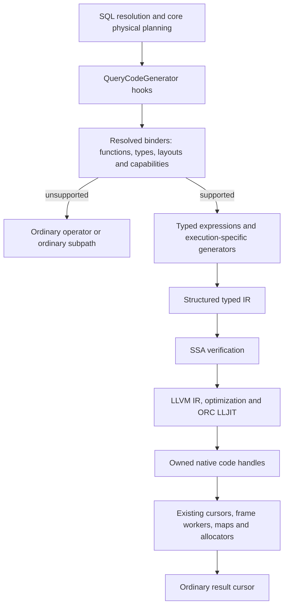

# Current architecture and correctness risks

Snapshot: 2026-11-08, branch `jh_blitzquest`, base commit `9100ce3eb671`, including
the uncommitted generalization changes. This describes the integrated SQL path as
it exists in the working tree. Proposed changes are identified separately. A source
review of the same snapshot verified the original claims, revised weaknesses 1-3,
5 and 8, added weaknesses 9-12 and reordered the recommended sequence. A second
review corrected the treatment of descriptor layouts, per-call SPI applicability,
the protocol checker's limits and adaptive policy.

Implementation milestones 1–5 are complete: shared-map lifetime belongs to the
execution owner, join insertion always publishes freshness, aggregate transition
emission is centralized, and binding and output readers share one specification
per supported ordinary implementation. Module tests check selected lifecycle
contracts while delegating to real kernels. Existing profile output reports
selected adaptive map alternatives. Descriptor initialization and resume checks,
immutable planning options and harness isolation are implemented. Milestone 6
records scope decisions, including deliberately retained limitations. Other
proposals below remain proposals. Validation is recorded in PROGRESS.

Two structural weaknesses dominate. Inside the module, shared generated arithmetic
still depends on execution-specific callers remembering initialization,
publication, finalization and lifetime rules. At the core boundary, core operators
call a wide, optional SPI whose ordering and mutation rules are now checked for
selected aggregate paths in module tests; default core CI never executes the
compiled branches. A typed IR checks some
properties of the emitted program; it does not establish that these SQL, ownership
and protocol rules were followed.

The recently discovered defects discussed below have been fixed. Their causes
identify remaining structural risks, not evidence that every affected path is
currently incorrect. This document is a source-grounded assessment supplemented
by focused milestone checks, not a claim of an exhaustive implementation audit.

## Purpose and boundaries

The north star is faster complete QuestDB queries through specialized generated
pipelines, while preserving ordinary SQL semantics, proven physical algorithms,
parallel execution and resource ownership. Improvements must generalize across
types, functions, data distributions and machines. Benchmarks supply controls and
counterexamples; their query names and schemas must not become admission rules.

The compiler is optional: an execution context installs `ResolvedQueryCompiler`
through core's `QueryCodeGenerator` interface. Registration is absent by default.
Core has no LLVM dependency. There is no JVM execution backend in this module. The
module builds only under the `query-compiler-prototype` Maven profile.

The branch also changes core planning and execution, including join fusion and
build-derived filtering. Relative to merge base `8da4e347f9`, including uncommitted
work, it changes 268 core main-source files (+10,382/-2,998 lines). Consequently,
this branch with generation disabled is a different control from QuestDB master.
A speedup can include a better core plan, generated execution, or both; those
effects need separate comparisons.

[README](README.md) records supported overloads and operating instructions.
[TODO](TODO.md) records open work and [PROGRESS](PROGRESS.md) records retained
outcomes. [AGGREGATE_DESIGN](archive/AGGREGATE_DESIGN.md) and
[PIPELINE_DESIGN](archive/PIPELINE_DESIGN.md) contain historical proposals and rationale;
their original implementation sequences are not descriptions of today's runtime.
The standalone `PhysicalPlan`/`PlanCompiler` controls also remain distinct from
the integrated SQL path.

## Compilation and execution

1. **Resolve ordinary semantics first.** Core selects concrete functions, types,
   key encodings, aggregate layouts and factories. The optional
   [QueryCodeGenerator](../../core/src/main/java/io/questdb/griffin/engine/QueryCodeGenerator.java)
   hooks expose these resolved objects to
   [ResolvedQueryCompiler](src/main/java/org/questdb/experimental/codegen/ResolvedQueryCompiler.java).
   Exact implementation checks prevent the compiler from assuming that every
   function with the same SQL name has the same semantics. Unsupported binding
   returns no compiled implementation; compilation failures propagate.
2. **Bind expressions and execution capabilities.**
   [ResolvedInputs](src/main/java/org/questdb/experimental/codegen/ResolvedInputs.java)
   and [ResolvedVarchar](src/main/java/org/questdb/experimental/codegen/ResolvedVarchar.java)
   bind columns, supported expression trees, cursor constants and helper inputs.
   Static SYMBOL predicates reuse dictionary IDs resolved at cursor initialization;
   reopen refreshes those values. SQL values retain explicit NULL semantics.
   Equal machine widths do not make INT, SYMBOL, IPv4 and FLOAT interchangeable.
3. **Emit the selected physical strategy.**
   [Pipeline](src/main/java/org/questdb/experimental/codegen/Pipeline.java) and
   [ScanPlan](src/main/java/org/questdb/experimental/codegen/ScanPlan.java) share
   expression and scan lowering. Aggregate, join, ASOF and sorting generators
   supply their own storage and control flow. Fusion, selection vectors, staged
   probing and materialization are physical choices; there is no universal loop
   that replaces every existing algorithm.
4. **Lower and compile.** [Ir](src/main/java/org/questdb/experimental/codegen/Ir.java)
   has explicit `I64`, `F32`, `F64`, `BOOL` and `ADDRESS` values and memory widths.
   Integer loads widen to I64; lowering preserves narrow SQL semantics where
   required. [LlvmBackend](src/main/java/org/questdb/experimental/codegen/LlvmBackend.java)
   lowers to verified SSA and LLVM text, then invokes the in-process bridge and
   ORC LLJIT. LLVM owns optimization, O2 by default. `SsaVerifier` checks the
   shared SSA representation before emission; there is no separate scalar optimizer.
5. **Invoke native code over borrowed storage.**
   [NativeCalls](src/main/java/org/questdb/experimental/codegen/NativeCalls.java)
   uses FFM to pass column/descriptor addresses, row counts and state addresses.
   LLVM text crosses the bridge at compilation, not per row. Allocator and
   cancellation callbacks go through
   [KernelMemory](src/main/java/org/questdb/experimental/codegen/KernelMemory.java).
   Supported helpers can remain calls inside generated execution; generated code
   does not imply that every operation is inlined.

## Execution families and their boundaries

| Family | Current mechanism | Boundary that must remain explicit |
| --- | --- | --- |
| Unkeyed aggregation | `ResolvedScalarAggregate` uses ordinary scalar state and promotes supported updates into IR variables. | Register state must be published at required boundaries; allocating state retains its ownership rules. |
| Keyed aggregation | `ResolvedAggregateKernel` and `AggregateSlot` generate updates and, where admitted, probing over actual QuestDB maps. Ordinary key probing can feed generated batch updates. | Ordinary and generated probes can establish new aggregate state differently. |
| Dictionary/dense aggregation | `DictionaryAggregate`, `DenseAggregate` and `ResolvedSymbolAggregate` use bounded domains and ordinary aggregate/vector contracts. | Eligibility, first-partial adoption and row/vector recurrences differ from generic map updates. |
| Aggregation over aggregate results | `ResolvedMapAggregate` consumes finalized source maps and supported projections in existing merge work. | Finalized values are not partial aggregate states. Intervening unsupported operators preserve a boundary. |
| Inner and dependent joins | Core join planning/build infrastructure supplies resolved layouts and dependencies; `ResolvedJoinKernel` fuses supported probes, expressions and aggregates. | Duplicate expansion, SYMBOL translation, payload lifetime and resume coordinates remain part of correctness. |
| ASOF | Separate generated lookup, scan and fused aggregate implementations cooperate with existing temporal strategies. | Forward and lookup progress differ. Fused ASOF currently admits a single same-type INT/LONG/SYMBOL key; inner-join key coverage does not imply ASOF coverage. Native regions never see fresh aggregate state because the cursor sends the first row through Java. |
| Selection, projection and ordering | Separate compiled contracts supply eligible filters, projections, Top-K and sorting operations. | One native operator does not establish full-query generated coverage. Result getters and ordering semantics are independent contracts. |

Useful entrypoints: [ResolvedScalarAggregate](src/main/java/org/questdb/experimental/codegen/ResolvedScalarAggregate.java),
[ResolvedAggregateKernel](src/main/java/org/questdb/experimental/codegen/ResolvedAggregateKernel.java),
[ResolvedMapAggregate](src/main/java/org/questdb/experimental/codegen/ResolvedMapAggregate.java),
[ResolvedJoinKernel](src/main/java/org/questdb/experimental/codegen/ResolvedJoinKernel.java),
[ResolvedAsOfJoin](src/main/java/org/questdb/experimental/codegen/ResolvedAsOfJoin.java)
and [ResolvedTopK](src/main/java/org/questdb/experimental/codegen/ResolvedTopK.java).

## Aggregate state contract

[AggregateUpdates.bind](src/main/java/org/questdb/experimental/codegen/AggregateUpdates.java)
recognizes resolved ordinary implementations, checks their assigned state layout
and constructs generated operations. Individual implementations such as
`MomentAggregate`, `WeightedAverageAggregate` and `BitwiseAggregate` emit typed IR.
The ordinary Java implementations remain separate executable definitions.

`AggregateUpdates.Update` currently exposes initialization, update, first/next
update, merge and finalization, plus state cells, result access and effect flags.
Two first-row predicates have different meanings:

- `requiresFirstRowInitialization`: the ordinary empty SQL state is not a valid
  numeric seed for generated updates.
- `requiresFirstUpdate`: the ordinary first-row operation cannot be reconstructed
  by applying the usual update to numeric state.

Neither property can safely be inferred from an aggregate count being zero. A
group may have consumed NULL rows, and a count can wrap. The first consumed row
and the first non-NULL value are also different events.

The actual state protocol includes empty-result handling, first-row handling,
subsequent rows, first-partial adoption, later merges and result finalization.
Some state contains owned or borrowed pointers. Adoption must preserve allocator
lifetime; initialization followed by merge is not universally equivalent to
copying the first partial state. Floating recurrence, signed zero, integer
overflow and sentinel collisions make algebraic simplifications unsafe without
an operation-specific proof.

Generated finalization can change the meaning of a stored cell. Output readers
must therefore match the finalized representation. `outputFunction()` currently
selects replacement readers with a separate aggregate-class list. The
`finalizesResult()` flag does not determine the reader: `BooleanAggregate`
finalizes its cell in place for empty groups and keeps the ordinary reader.

## Ownership, reopening and failure

| Resource | Current owner or lifetime | Required invariant |
| --- | --- | --- |
| Compiled kernels and helper code | Factory/prepared objects; some alternatives compile lazily. | Code survives all worker calls and closes after their users drain. |
| Adaptive alternative policy | Each `AdaptiveKernel` instance keeps a `ThreadLocal` policy, so learning persists per compiled kernel and worker thread across executions; independent compiled queries do not share it. | Alternatives are semantically equivalent. Whether learning should persist across executions is a performance policy, not a correctness invariant. |
| Page frames, snapshots and input bytes | Existing QuestDB cursor/frame infrastructure. | Borrowed addresses remain valid for the call; retained transient bytes are copied. |
| Ordinary maps and worker allocators | Existing atoms, sharding contexts and acquired slots. | Native code mutates borrowed representations without taking over their destruction. |
| Per-slot descriptors and scratch | `AggregateSlot`, helper slots and dictionary slots. | Clear releases scratch; reopen rebuilds every address-dependent binding. |
| Shared VARCHAR map descriptors | `Prepared.sharedMaps` (a default-off control), initialized and cleared through owner-level `CompiledUpdates` hooks. | Shared state remains active until all scan, merge and output users drain; clearing worker scratch does not reset it. |
| Allocation and cancellation status | `KernelMemory` and existing query trackers/breakers. | Failures return to Java through the defined protocol; Java exceptions do not unwind through native code. |

Core's [GroupByKernel](../../core/src/main/java/io/questdb/griffin/engine/groupby/GroupByKernel.java)
already provides owner-level `prepareExecution`, `finishScan` and
`clearExecution` hooks, and `ResolvedQueryCompiler.CompiledUpdates` implements
them. `AsyncGroupByAtom` and `GroupByShardingContext` integrate these with the
ordinary parallel lifecycle. `GroupByShardingContext.reopen()` receives the owning
kernel and calls its `initSharedMaps()` hook. `CompiledUpdates.clearExecution()`
resets the binding after work drains. Slots retain `finishSharedMap()` because
finishing borrows their scratch and rehash callbacks.

The [MapKernelState](src/main/java/org/questdb/experimental/codegen/MapKernelState.java)
ABI describes resumable requests such as map growth, key insertion, copying,
staging and partition flushing. A resumable exit identifies the pending input
position before that row's aggregate update. Java services the request, refreshes
invalidated views and resumes. Staged candidates are rebuilt when necessary.

Unsupported storage can use ordinary execution before the relevant mutation.
After partial mutation, a failed execution must be cancelled and drained; replaying
it through ordinary execution would risk duplicate updates. Column tops, lazy
conversions and Parquet eligibility must be checked for the actual consumer.

Reopening is a real lifecycle operation. Reusing compiled code does not imply
that old descriptors, parameters, helper bindings or map views remain valid.

## Architectural weaknesses and smells

### 1. Aggregate transition emission depended on each consumer (centralized)

**Evidence and implementation.** Consumers still obtain freshness from their own
physical protocols, but `AggregateUpdates` now decides which seed writes and
first/next update operations to emit:

- Ordinary batches call `emitEmptyFrame()` with their new-entry bit. It converts
  ordinary `setEmpty` state to update seeds only where required.
- Scalar and join paths call `initializeEmptyState()` with the Java fresh word or
  `MATCHED < 0`. A compiler-time callback places the writes in memory or promoted
  registers; joins also publish their resume marker. `firstUpdateFlag()` captures
  first-row evidence before that marker changes.
- Generated map, staged, dictionary and raw-input partition probes use the shared
  `initializer()` callback and pass its insertion evidence to `emitInitialized()`
  or `emitFrame()`. Nested map aggregation uses the same update emission.
- Partial-state partition merging retains its different contract: adopt/copy the
  first partial state, then merge existing states. It does not reseed a populated
  partial state as though it were a new input row.
- `emitRosti()` preserves Rosti's per-function rule: only the first function sees
  key creation; later functions see slots initialized by the first function.
- ASOF calls `emitExisting()`. Its core SPI documents that Java `updateNew` consumes
  the first row before either compiled region. A delegating test observes that
  handoff, exercises both strategies and checks cursor reopening.

The two aggregate predicates remain distinct: a state can require first-row seeds,
exact first-update behavior, both or neither. Consumers no longer inspect those
predicates themselves. This is compiler-time composition, with no runtime virtual
dispatch added. Repeated-row updates preserve their existing order and polling.

**Why it matters.** Ordinary probing previously installed `setEmpty` state where
some generated updates needed different seeds. Join insertion also published
`MATCHED = -1` only for aggregates requiring reseeding, despite other aggregates
needing first-update evidence. Milestone 1 made publication unconditional;
milestone 2 centralizes consumption of that evidence. ASOF's Java-first-row
contract is now explicit and tested.

The new ASOF test intentionally leaves the optional forward-scan kernel absent.
It exposed a separate boundary defect: a compiled aggregate may consume exactly
to an RHS frame end, and Java's scalar scan then entered a `do/while` and read past
the frame. The scan now advances frames without reading when the current frame is
exhausted. The regression composes aggregation with scalar and compiled filtering;
enabling the forward-scan kernel had masked this path.

**Remaining direction.** The emitter still trusts callers' evidence and declared
state layouts. Milestones 3 and 4 address the binding specifications and complete
descriptor initialization. Selected protocol tests do not prove all SPI call
orders or all state transitions correct.

### 2. Shared execution lifetime crossed worker-local cleanup (resolved)

**Evidence.** [AggregateSlot](src/main/java/org/questdb/experimental/codegen/AggregateSlot.java)
owns scratch and exposes finishing of
[SharedVarcharMaps](src/main/java/org/questdb/experimental/codegen/SharedVarcharMaps.java).
Before milestone 1, its `clear()` also reset shared maps and core initialized them
through updater 0. Initialization and reset now belong to `CompiledUpdates`;
`AggregateSlot.clear()` only clears slot resources. `Prepared` still combines code
handles, lazy strategy preparation and mutable execution-related objects.
The shared path is an algorithm control: `ResolvedAggregateKernel`
compiles it only under `-Dquery.codegen.sharedVarchar=true`, and only for
`COUNT(*)` over a direct VARCHAR key without bounded local state.

**Consequence.** A scratch cleanup refactor introduced a regression: reopening one
slot cleared the execution-wide map binding. The regression now has a direct
test: clearing and reopening scratch must leave the shared binding active. The
existing SQL test covers growth, ordinary fallback, failure, memory limits and
owner clear/reopen with LLVM. The default path does not enable this algorithm control.

**Remaining direction.** Preserve owner-only shared initialization/reset and
slot-local cleanup. Further changes must keep complete descriptor rebinding,
including nested-merge helpers, and the established drain and allocator ordering.
The control remains available; no strategy or default changed.

### 3. Aggregate binding and result descriptions were independent (consolidated)

**Implementation.** [AggregateSpecs](src/main/java/org/questdb/experimental/codegen/AggregateSpecs.java)
contains one closed specification per supported ordinary implementation class.
Each specification defines its argument binding, state slot types, generated
update factory, consumer requirements and output reader. Both `AggregateUpdates`
and the prepared output readers use it. The former class chain, separate reader
list and per-update `supports()`/class-selection methods have been removed.
Admission still uses exact implementation classes; this is not a plugin interface.

One validator checks slot bounds, exact types and overlap for all these bindings.
Offsets still come from the actual map/value layout. Only grouped Top-K requires
contiguous LONG cells; ordinary aggregates accept displaced slots. Timestamp
extrema retain the resolved timestamp type, including its precision. DISTINCT's
payload offset still comes from its actual second slot, and its capacity and load
factor come from the ordinary function.

Reader choice is explicit: AVG, NSUM, moments, covariance, regression and weighted
average use a DOUBLE column after finalization. Boolean aggregates finalize their
state but keep their ordinary reader. KSUM also retains its ordinary getter. A
specification requiring a finalized DOUBLE reader must produce an update declaring
finalization and finalized result access; binding checks that contract.

**Why it matters.** Previously, adding an update could leave the output-reader
class list or a family-specific slot check behind. The new tests compare declared
layouts against ordinary `initValueTypes()` and reject wrong types in each state
cell, overlapping slots, invalid bounds and unsupported subclasses. Existing
mixed Java/native state and SQL composition tests cover the generated operations
and final readers.

**Remaining limits.** Update records still declare promotion state, allocation,
merge and finalization behavior. Those properties describe the emitted algorithm;
the specification does not mechanically prove them. Rosti uses its own vector
binding and recurrence contracts. Ordinary and generated semantics remain
separate implementations, and descriptor initialization is the next milestone.

### 4. Ordinary and generated semantics remain separate implementations

**Evidence.** Ordinary `GroupByFunction` methods and generated `Update` emitters
both implement recurrences and edge cases. Row and vector variants can legitimately
differ. The existing aggregate design explicitly distinguishes integration from
sharing a single executable semantic definition.

**Consequence.** Matching names, formulas or state widths can hide differences in
NULL handling, first-row behavior, rounding, overflow and merge adoption. A future
ordinary implementation change can leave its native lowerer stale.

The constant-aggregate defects illustrate a separate failure above native
lowering: ordinary factories folded constant arguments into scalar constants,
losing empty-input/cardinality behavior or XOR parity. Stock/native comparison
alone cannot detect a bug shared through ordinary resolution. Those factory
shortcuts have been removed for the affected functions.

**Proposed direction.** Keep explicit correspondence to ordinary implementations
and exact mixed Java/native state tests. Aggregate rewrites need aggregate-level
proofs; constant arguments alone are insufficient. A single definition generating
both ordinary and native implementations is a possible later experiment, not an
implemented property or a prerequisite for the smaller ownership fixes. It needs
independent expected results and ordinary-path performance validation.

### 5. Typed IR does not encode the entire memory and resume protocol

**Evidence.** IR addresses have a type, but descriptor fields, state offsets and
resume positions are mostly raw offsets and integers. `MapKernelState`,
`ResolvedJoinKernel` and `ResolvedAsOfJoin` share named constants between emission
and runtime binding. `ResolvedScalarAggregate` now shares one descriptor across
its scan emitters and slots; its fresh-word location is derived once from input
and filter storage. SSA verification still does not prove pointer lifetime or
whether a retry repeats an already committed update.

**Implemented.** New scalar/join descriptor allocations start zeroed. Every join
binding explicitly resets its function-cardinality word; previously its first
native invocation could read an uninitialized value while subsequent invocations
saw the cleanup zero. A regression poisons that word before binding and checks
zero across scalar/keyed, selection and duplicate-product controls.

Join symbol/key/staging requests check resume positions before servicing them;
symbol requests also validate their build, key and translator. ASOF shares region
binding for both strategies, checks its input span and validates completed progress
before publishing it. Context cleanup runs even if publication rejects corrupted
native progress. Scalar decline checks retain both fresh and populated state;
join and ASOF tests cover reuse and failure/reopen boundaries. All checks are at
invocation boundaries, without adding generated per-row dispatch.

**Remaining risk.** Validated ranges do not prove every descriptor pointer's
lifetime, mode-specific RHS coordinate or exactly-once update. Existing retry,
mixed Java/native and failure tests remain necessary. Do not replace the compact
layouts with a generic descriptor framework unless it prevents a demonstrated
class of mistakes.

### 6. Expression safety depends on conservative admission

**Evidence.** `ResolvedInputs.predicateNode()` admits total, side-effect-free
leaves. `Pipeline.Conditional` documents that `Select` may evaluate both branches.
The current extension boundary for checked temporal conversions is therefore
semantic, not merely a missing machine instruction.

**Consequence.** Admitting a throwing, volatile or stateful expression under an
existing eager transformation can change which rows or branches evaluate it.
Machine-level type correctness cannot establish evaluation-order correctness.

**Proposed direction.** Preserve conservative fallback. Before admitting such an
expression, define its evaluation effects and emit lazy control flow where
ordinary execution requires it. Do this for a concrete function family rather
than preemptively adding a general compiler effects framework.

### 7. Support is a combination of contracts, not a list of SQL types

**Evidence.** FLOAT works in aggregate consumers while the standalone
`CompiledProjection.getValue()` contract still returns an integer-style `long`.
Inner joins admit broader primitive/composite keys than fused ASOF. VARCHAR
DISTINCT uses ordinary Java set objects and lacks the fixed-width native set's
parallel merge contract. A supported value can still require fallback for a
particular storage representation or consumer.

**Consequence.** Adding a type in one binder can appear to establish much broader
coverage than the runtime actually provides. Positive benchmarks exercise only a
small fraction of combinations.

**Proposed direction.** Track concrete consumer contracts and intentional fallback
boundaries. Generalization checks must cross types, aggregate families, key shapes,
storage forms and lifecycle transitions, with deliberate negative cases. Keep the
detailed coverage list in the README rather than duplicating it here.

### 8. Orchestration classes combine too many decisions

**Evidence.** At the initial review, `ResolvedJoinKernel` was about 1,790 lines,
`AggregateSlot` 1,442 and `AggregateUpdates` 970. Their responsibilities include
semantic binding or emission alongside strategy selection, state publication,
resumption and lifecycle handling. `ResolvedAggregateKernel.Prepared` holds 29
nullable `CompiledKernel` fields, two `AdaptiveKernel` choices and strategy fields
that planning calls set later (`topKType`, `longSortType`, `topKOrder`, ...); the
null/non-null combination encodes which strategies are active. `AggregateSlot`
overrides 36 methods, nearly the whole `GroupByKernel.Updater` interface, and
reads `prepared` fields 158 times. `ResolvedJoinKernel` divides into binding and
layout (about 290 lines), IR emission (about 690) and runtime `Prepared`/`Slot`
(about 630), which share the named control-block offsets. File size is a symptom; the
important issue is how many independent invariants a local change can affect.

**Consequence.** New execution strategies increase the combinations a reviewer
must reason about. Adaptive performance choices can obscure which mechanism ran,
and a strategy that is legal is not necessarily profitable on another machine.
Splitting `AggregateSlot` without narrowing the SPI it implements (weakness 9)
would move code without reducing those combinations.

**Proposed direction.** First extract shared transitions and correct ownership
boundaries. Then group strategy fields into per-strategy records that are null as
a unit (partitioning, rank/split, union, Top-K, sorting), so partial combinations
become unrepresentable; this costs one dereference per call, not per row. For the
join kernel, the natural seams are binding, emission and runtime, joined by the
existing control-block constants and the rebinding checks from weakness 5. Moving branches into numerous
forwarding classes would not reduce the invariants. Preserve strategy alternatives
and measure complete-query work; do not unify all physical algorithms to make the
class diagram smaller.

### 9. The core SPI is wide, optional and checked only by documentation

**Evidence.** `GroupByKernel` declares 22 owner methods and its `Updater` 36,
mostly defaults that decline by returning `false`, `-1` or `null`, or that throw
`UnsupportedOperationException`. The 12 compiled interfaces in core span about
1,100 lines. The branch adds 11 optional methods to `RecordCursorFactory` and
`RecordCursor` (`limitGroups`, `selectRows`, `selectSortedRows`, `sortLong`,
`prepareRowLimit`, `prepareGroupLimit`, `prepareSortedRowLimit`, `prepareLongSort`,
`recordCursorSupportsCompiledLongTopK` and two `prepareLongTopK` overloads).
Wrapper factories such as `SelectedRecordCursorFactory` and
`VirtualRecordCursorFactory` forward each one and decide individually whether
column remapping or function stability permits forwarding. Nine core operator
classes contain about 400 references to compiled contracts. Rules such as "false
only before mutation", "called exactly once after every partial state has merged"
and "owner-only after all workers drain" exist only in Javadoc.
`QueryCodeGenerator` keeps overload chains (four `compile`, three `compileJoin`,
including a legacy single-INT join hook), although its only implementers are this
module, `HandwrittenCountSum` and tests.

**Consequence.** Module correctness depends on core callers honoring an ordering
protocol that nothing checks. Core builds without this module, and core tests
install a compiler only through an external runner (`QueryCodegenTestSupport`).
Default core CI therefore executes none of the compiled branches, so a master
change to `AsyncGroupByAtom`, `GroupByShardingContext` or a wrapper factory can
break the protocol without a failing core test.

**Implemented checks.** The existing aggregate test wrapper delegates to real
kernels and checks owner/worker preparation, draining before finishing or cleanup,
and worker cleanup before shared reset. It tracks scan calls and selected merge
and finalization calls, not every optional SPI method. A separate ASOF wrapper
checks execution preparation and the Java-first-row handoff to both native
strategies. Focused batch, scalar and join tests observe state around declined
calls; scalar checks cover both fresh and populated state. Deliberate omitted
preparation/first-row updates and a write before decline are detected.

Delegation observes calls, not effects, so those state observations remain
necessary. The wrappers cover selected aggregate contracts rather than the
complete SPI. They run in module tests and leave the default core CI gap unchanged.
Closing that gap needs a separate decision to run a compiled path in CI, weighed
against CI cost.

**Remaining direction.** Group the optional `Updater` capabilities into nullable capability objects
that core obtains once per execution (partitioning, parallel merge, Top-K and
sorting, shared maps, fused filtering). This simplifies discovery and makes legal
combinations explicit. It does not replace per-call applicability. Methods such
as `AggregateSlot.updateFiltered()` decline individual frames whose inputs, key
columns or predicates are unsupported. The capability contract must keep each
call's check and its fallback before mutation.

Third, replace the `QueryCodeGenerator` overload chains with one request record
per family. None of these adds per-row dispatch.

### 10. One compiler backend

**Implemented.** LLVM is the sole compiler backend. The experimental C and AsmJit
backends, their helper/vector lowering, custom optimizer, source emitter,
instruction protocol and SSA destruction have been removed. SSA construction and
verification remain shared by the LLVM scalar, vector and helper emitters.

**Reason.** The alternatives required parallel implementations of IR semantics and
platform support. They provided potential differential coverage, but the retained
progress log did not identify defects detected uniquely by those backends. Their
maintenance cost no longer justifies full IR parity.
Archived [compilation experiments](archive/FOUNDATIONS_PLAN.md) did find lower
AsmJit preparation latency; no automatic tiering policy was retained. That
historical evidence remains available if compilation latency warrants revisiting.

IR execution checks now run on LLVM. SQL comparisons against ordinary QuestDB,
aggregate-state checks, worker/type variations and lifecycle tests remain.
Handwritten C performance references compile independently of the removed C
backend. QuestDB's ordinary filter JIT is outside this change.

### 11. Global switches and execution-spanning adaptive state select mechanisms

**Implemented.** `CompilerOptions` captures expression admission, bounded-map
policy/capacity, prefetch rows, shared VARCHAR, ordered merge and large Top-K
choices. `ResolvedQueryCompiler` reads that snapshot at construction or receives
one explicitly. The same snapshot reaches aggregate/key/filter binding, nested
consumers and deferred kernels. Direct aggregate bindings also retain it when
preparing later filters. Tests supply options instead of mutating these global
planning properties. No switch or default was added.

Instrumentation and prefetch controls (`profile`, `probeCounters`, prefetch
hints) have a separate immutable process snapshot. Native library paths remain process-loader inputs. Treating these as
independent per-query choices would misrepresent the existing library and static
diagnostic lifetimes; this is a deliberate refinement of the original proposal.

**Decision.** Retain `AdaptiveKernel` learning per compiled kernel and worker
thread. Two alternatives need four warm-up and ten measured calls, each with at
least 4,096 rows, before choosing. Resetting every execution would prevent shorter
cached queries from accumulating that evidence. A reset policy therefore needs a
controlled workload experiment, not inclusion in an architecture-only cleanup.
The profile output counts actual plain/staged choices, including exploration.
Retained learning can still hide alternative-specific bugs unless tests exercise
both alternatives explicitly.

### 12. Harness isolation and historical plans

**Implemented.** Twenty-three standalone matrices, demos, physical-plan executors
and reference helpers now live in `src/test/java`, using the existing Maven test
source set. Production classes no longer compile against these executors. The
launch scripts include `target/test-classes`; normal integration needs only
production classes and native libraries. No new module or source-set plugin was
introduced.

`PhysicalPlan` still belongs with `ScanPlan.from`, and `HandwrittenCountSum` remains
because the aggregate binding directly exposes its reference compilation. They are concrete
remaining dependencies, rather than executor classes accidentally left behind.
Shared-type refactors still need harness compilation checks.

Eleven historical plans moved to `archive/`, with relative links updated. README,
ARCHITECTURE, TODO and PROGRESS are the maintained documents. This archive contains
existing design history, not copies of benchmark results.

## Validation strengths and remaining blind spots

Existing validation includes exact aggregate-state tests, mixed Java/native
updates, SQL differential tests, LLVM optimization-level checks, fault/reopen checks
and the ordinary query fuzzer with an additional compiler axis. The recent generalization
run is recorded in PROGRESS; its counts are not a proof of complete coverage.

Five limitations matter architecturally:

- A native call proves that some generated code ran. It does not prove that the
  target aggregate or every data-processing operator ran natively. Tests need the
  relevant plan and execution evidence.
- Ordinary execution is a valuable oracle, but shared resolution/optimizer bugs
  require independent expected results and valid literal/bind/column equivalences.
- Tests of individual arithmetic emitters do not exercise every caller's state
  protocol. Empty input, NULL prefixes, first partials, batch boundaries, retries,
  cancellation and reopening need deliberate coverage across actual consumers.
- Default core CI installs no compiler. Core-side compiled branches and their call
  order run only in module tests and opt-in runs.
- A non-winning adaptive alternative runs only during warm-up or exploration, on
  frames of at least 4,096 rows. Unless a test forces it, its coverage depends on
  data size and on earlier executions of the same compiled kernel on each thread.

Useful existing tests include [DoubleStateTest](src/test/java/org/questdb/experimental/codegen/DoubleStateTest.java),
[WeightedAverageTest](src/test/java/org/questdb/experimental/codegen/WeightedAverageTest.java),
[BitwiseStateTest](src/test/java/org/questdb/experimental/codegen/BitwiseStateTest.java),
[ResolvedSqlAggregateTest](src/test/java/org/questdb/experimental/codegen/ResolvedSqlAggregateTest.java)
and core's [ConstantAggregateTest](../../core/src/test/java/io/questdb/test/griffin/engine/functions/groupby/ConstantAggregateTest.java).
The shared-map growth/failure/reopen test caught the introduced cleanup regression.
The fuzzer's aggregate-family expansion caught combinations that earlier workloads
did not generate. We do not have a defensible estimate of remaining latent bugs.

## Recommended architectural sequence

Milestones 1–5 are implemented. Milestone 6 records explicit scope decisions.
The implementation order reflected risk removed per unit of work:

1. **Complete:** shared-map initialization/reset belong to `CompiledUpdates`;
   Java join insertion writes `MATCHED` unconditionally; the adaptive scope comment
   and selected-alternative profile counters describe the existing policy.
2. **Complete:** centralized aggregate transition emission, preserving consumers'
   freshness evidence, state layout, update order and physical algorithms. Added
   delegating checks for aggregate lifecycle and ASOF handoff, explicit state
   observations around declines, and the ASOF frame-boundary regression/fix.
   These checks cover selected contracts; broader SPI checking remains open.
3. **Complete:** replaced binding's class chain and independent reader lists with
   per-implementation specifications carrying argument, state, update and reader
   contracts. One validator checks slots; Rosti retains its separate semantics.
4. **Complete:** shared scalar descriptor, complete initial descriptor storage,
   explicit join-counter rebinding, checked join resume requests and ASOF
   publication positions, including corruption/failure/reopen checks.
5. **Complete:** immutable planning/process option snapshots; standalone harnesses
   moved to the existing test source set; historical plans archived.
6. **Implemented:** LLVM is the sole compiler backend. Retain per-kernel adaptive
   learning as described above. Keep the current optional SPI and opt-in compiled
   test runner for this prototype. Capability-object grouping and default core CI integration remain
   open work, not completed implementation.

The SPI decision avoids a second representation of capability combinations while
per-frame checks still govern applicability. A later grouping should replace the
old calls end to end, with tests of wrapper forwarding and legal combinations;
adding capability objects alongside the existing methods would increase drift.
The module's real-kernel lifecycle checks improve the current boundary now.

The CI decision preserves the optional Maven profile and LLVM/PCRE2 toolchain
boundary. Existing core CI does not build this module or install a compiler;
there is still no automatic protection for those compiled branches in that CI.
For changes to compiled core contracts, run module lifecycle tests and the existing
`run-griffin-tests.sh` control explicitly. A dedicated compiled CI lane is useful
future work, with its toolchain and execution budget measured separately; this
cleanup does not claim to have closed that gap.

Success means fewer independently maintained correctness rules. For already
supported state families, adding an aggregate should not require editing first-row
logic in each scan/join consumer. Clearing one worker slot should not reset shared
execution state. A core change that breaks the compiled call order or mutates
before declining should fail a module test, and default CI as well if it gains a
compiled path. A new IR operation needs LLVM lowering and semantic execution
checks. Existing ABI, result and lifecycle tests must still pass, and
generated hot loops should acquire no unnecessary branches, allocation or dispatch.
Small deliberate fault mutations can check that the relevant tests detect the
mistakes these changes are intended to prevent.

Retain the useful foundations: ordinary function resolution, real map layouts,
existing scheduling and allocators, conservative admission, multiple physical
strategies, typed IR, and LLVM compilation controls. Improve the
boundaries around them one at a time. Architectural cleanup should reduce
opportunities for mistakes while preserving the mechanisms responsible for
performance.
